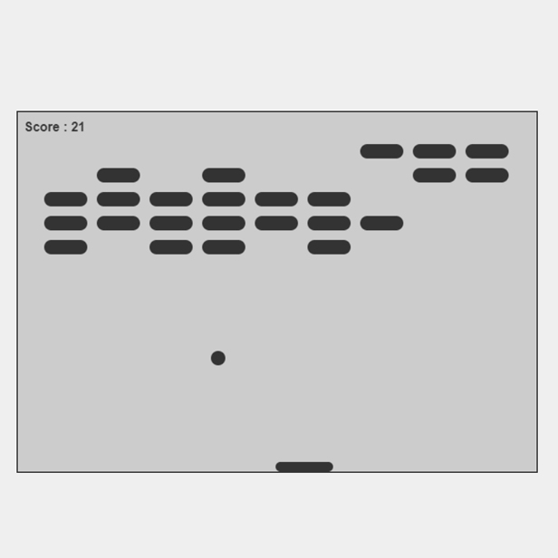

# Breakout Game

The classic brick-breaker game drawn on an HTML canvas with plain JavaScript.

## Features

- Paddle follows the mouse
- Ball bounces off walls, paddle and bricks
- Score counter
- "You Win" when every brick is broken; the game restarts when the ball is missed

## Run it

No build step. Open `index.html` in a browser, or serve the folder with any static server, for example `python -m http.server`.

## Screenshots

